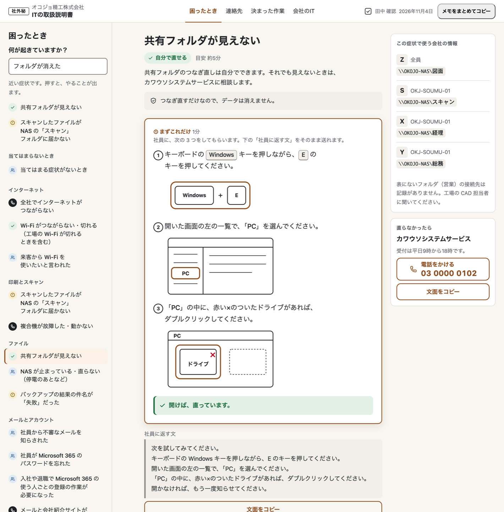
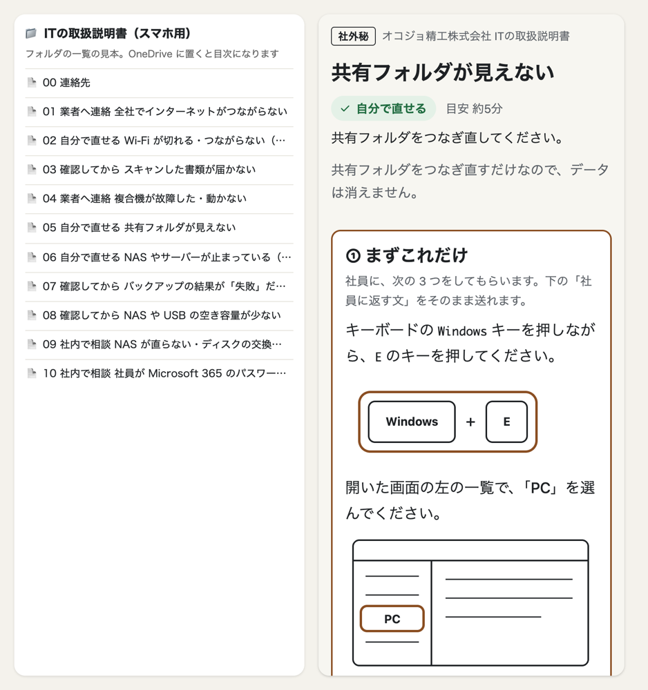

# ヒキツギ

**ひとり情シスが辞める日に、会社の IT を「一次受け」ごと引き継ぐ Claude Code プラグインです。**

> Built with Claude: Japan 2026 の参加作品です。企業、人物、業者はすべて架空です。数字はすべて模擬評価です。

**動画（3 分）：** https://youtu.be/Ld0LPc5LTOU

**目次：** [何に困っているのか](#何に困っているのか)／[何をするか](#ヒキツギは何をするか)／[どう試すか](#どう試すか)／[使い方](#使い方)／[なぜ Claude Code のプラグインか](#なぜ-claude-code-のプラグインなのか)／[数字の見方](#数字の見方すべて模擬評価)／[限界と残課題](#限界と残課題)／[作り方](#作り方)／[出典](#動画で使った統計の出典)

## 何に困っているのか
小さな会社の多くでは、IT をひとりの社員がほかの仕事と兼ねて見ています。その人が辞めると、IT 未経験の総務担当が後任になります。後任は、社員からの「共有フォルダが見えない」などの相談を、最初に受ける役（一次受け）になります。

引き継ぎの書類は、残らないことが多いです。残っても、IT を知らない後任には読めません。

## ヒキツギは何をするか
退職する担当者（前任者）が質問に答えるだけで、後任が使える取扱説明書ができます。

1. **前任者が PC を調べます。** 読み取るだけのスクリプトで、外へは送りません。必須の 40 項目と比べて、足りないところ（空白）が分かります
2. **前任者が、空白について 1 問ずつ答えます。** 質問は最大 20 問です。パスワードは聞かず、保管場所だけを聞きます
3. **AI が書いた手順の文を、すべて根拠と照らし合わせます。** 根拠のない文は書き直しに戻ります。最後に前任者がページごとに確かめます
4. **後任は説明書を開くだけです。** 社員に言われたままの言葉で探すと、どうすればよいかと、社員に返す文が出ます

どうすればよいかは、4 つの判定で出ます。「自分で直せる」「確認してから」「業者へ連絡」「社内で相談」です。

<p> </p>

## どう試すか
試し方は 3 つあります。上から順に手軽です。

### A. 見るだけ（5 分、インストール不要、無料）
架空の会社「オコジョ精工」の、できあがった説明書を開きます。

1. GitHub の緑の「Code」を押し、「Download ZIP」を選びます。ダウンロードした ZIP を展開します
2. `samples/okojo/manual.html` をダブルクリックします。ブラウザーで開きます
3. 左の「困ったとき」の欄に「フォルダが消えた」と入れます。「共有フォルダが見えない」を押します
4. 判定「自分で直せる」と、手順の図が出ます。下の「社員に返す文」の「文面をコピー」を押すと、文がコピーされます
5. 上の「連絡先」「決まった作業」「会社のIT」のタブも開けます。各ページの「後任のメモ」には、後任が自分で書き足せます

展開した ZIP の中の `samples/okojo/phone/` フォルダを、そのまま OneDrive に置きます。スマホの OneDrive アプリで開きます。フォルダの一覧が目次になります。

サンプル：[PC 用](samples/okojo/manual.html)、[スマホ用の束「ITの取扱説明書（スマホ用）」](samples/okojo/phone/)、[更新用のデータ](samples/okojo/manual.json)

### B. 動かす（Windows なし、約 1 時間 10 分）
同梱の調査データを使い、前任者の役で最初から通します。Windows の PC は要りません。

- **要るもの：** Node.js 22 以上と Claude Code です。Claude の Pro か Max の契約か、API キーが要ります
- **費用：** Pro か Max の枠なら、追加の費用はかかりません（契約の利用枠は使います）。API キーの場合の費用は、次の「C」を見てください
- **時間：** 録画のための通しで、約 1 時間 10 分でした。質問に答える部分は約 18 分です

1. 下のコマンドで準備し、Claude Code を開きます。最初の確認では「Yes」を選びます
   ```
   git clone https://github.com/devmmou-cpu/hikitsugi.git
   mkdir handover; cd handover
   claude --plugin-dir ../hikitsugi/plugin
   ```
2. `/hikitsugi:start` と入力します。会社名と、退職する人の名前を聞かれます。例：オコジョ精工株式会社、田中
3. 「すでにまとめた調査データがあれば」と聞かれます。Claude Code を開いているフォルダから見た場所で答えます。`../hikitsugi/eval/sets/okojo/input/survey.json` です
4. 質問には自由に答えてかまいません。答えに困ったら、`docs/video-rehearsal.md` の「聞き取りの回答例」を使えます
5. 最後に、ページごとに「このままでよい」か「直す」を選びます。PC 用とスマホ用ができあがります

### C. 本番どおり（Windows の PC 1 台以上、約 1 時間 10 分＋調査）
実際の会社の PC を調べるところから通します。

- **要るもの：** B と同じものに加えて、調べる Windows の PC です。管理者の権限は要りません
- **費用：** Pro か Max の枠なら、追加の費用はかかりません（契約の利用枠は使います）。API キーで Claude Code を通した費用の記録はありません。同じ担当とモデルを API で通した模擬評価では、1 社 $1.99〜2.60 でした
- **時間：** 調査は 1 台あたり約 10 秒です。あとは B と同じです

1. B の 1 と 2 のとおりに始めます。調査データはまだないと答えます
2. 画面に、調査のコマンドが出ます。調べる PC の PowerShell で実行します
   ```
   powershell -NoProfile -ExecutionPolicy Bypass -File "<プラグインのフォルダ>\scripts\survey.ps1"
   ```
3. 集める内容と集めない内容が出ます。よければ `y` を入力します。パスワードやファイルの中身は集めません
4. `hikitsugi-survey-<PC 名>-<日付>.json` ができます。メモ帳で開き、渡したくない内容がないか確かめます
5. PC が何台かあれば、同じスクリプトを USB メモリなどで運び、1 台ずつ実行します。結果のファイルは Claude Code がまとめます
6. 結果のファイルを、Claude Code を動かす PC に置きます。あとは B の 4 と 5 と同じです

調査の実機の確認は、Windows 11 の 1 台です。Claude Code での通しは Mac で行いました。

### うまくいかないとき
- `hikitsugi` のリポジトリの中で開かないでください。開発用の検査が動きます
- Node.js は 22 以上が要ります。確認した Claude Code は 2.1.318 です
- 開発者向けのテストは、リポジトリの中で `npm test` です

## 使い方
### 前任者（退職する担当者）
Claude Code で `/hikitsugi:start` を実行し、案内に従います。調査、最大 20 問の質問、ページごとの確認をします。録画の通しでは、人の手直しなしで約 1 時間 10 分でした。できあがるのは、PC 用の 1 ファイルと、スマホ用のフォルダです。最後に、次のような要約が出ます。

`空白 16 件 → 質問 20 問 → 書いたページ 15 → 差し戻し 0 回（0 文）→ 確認 15 ページ`

### 後任
後任には、Claude のアカウントもアプリも要りません。PC 用の 1 ファイルを開き、社員に言われたままの言葉で探します。出てきた「社員に返す文」をコピーして、社員に返します。スマホでは、OneDrive のフォルダの一覧から症状のファイルを開きます。JavaScript が動かない表示でも、全文が読めます。

PC 用では「後任のメモ」を書けます。メモはブラウザーに保存され、照らし合わせの対象外だと画面に出ます。

### 担当が代わったら
前任者と同じ `/hikitsugi:start` から、説明書をページ単位で直せます。1 回の更新は約 2〜8 分で、費用は約 $0.18〜0.86 でした（API で実測）。Pro か Max の枠なら、追加の費用はかかりません（契約の利用枠は使います）。直したページは、PC 用、スマホ用、更新用のデータのすべてに入ります。いつ、誰が、どのページを、何のために直したかが「更新の記録」に残ります。

更新でできることは 4 つです。11/4 に、実物で 4 つとも動かしました（`docs/journey.md`）。
- 連絡先を直す（電話番号など）
- 症状を足す（新しいページができる）
- 手順を直す
- 後任のメモから取り込む

元のデータ（`hikitsugi-work/` と `manual.json`）は、説明書と同じフォルダに置いてください。同時に 2 人で更新しないでください。

## なぜ Claude Code のプラグインなのか
- **手間を前任者の側に寄せます。** 前任者は、Claude Code の会話で質問に答えるだけです。後任には何も入れず、ログインもありません。
- **データを外に出しません。** 中身は、サーバーの場所や業者の電話番号です。調査は PowerShell の読み取りだけで、できあがりは HTML と OneDrive で完結します。
- **役割ごとに分けた作りを、そのまま組めます。** 「聞く・書く・直す・照らし合わせる」を別々の担当（エージェント）に分け、プログラムが検査します。Claude Code のエージェント、スキル、フックで、そのまま組めます。Web アプリを一から作るより小さく、確かめやすくなります。
- **弱点：** 前任者と更新する人には、Node.js と Claude Code の導入が要ります。

## Claude の活用
| 担当 | 役割 | モデル（effort） |
|---|---|---|
| Gap Finder | 調査データと必須 40 項目を比べ、聞くべき空白を出す | Sonnet（medium） |
| Interviewer | 次の 1 問を作る。回数が多いので軽くする | Sonnet（low） |
| Writer | 根拠のある文だけで、部分ごとに書く | Sonnet（high） |
| Editor | やさしい日本語に直す | Sonnet（medium） |
| Phrase Writer | 社員の普段の言い方で、探すための言葉を作る | Sonnet（low） |
| **Verifier** | **全文を根拠と照らし合わせる** | **Opus（high）。見逃すと後任が間違えるので、ここだけ一番強いモデル** |

- **AI が出すのは、文章とデータだけです。** 形は構造化出力（決まった形のデータ）で決めています。プログラムが検査し、通らなければ先へ進みません。画面は、AI ではないプログラムが組み立てます。
- **Editor が数字や名前を変えたら、プログラムが元に戻します。**
- **フック（決まった操作の前後に自動で動く検査）が 2 つあります。** 開発用です。`git push` の前に全テストを流します。書き出した HTML に、パスワードらしい文字列や実在の形の番号があれば止めます。

## 数字の見方（すべて模擬評価）
前任者も後任も、AI が演じた模擬です。読み方は次のとおりです。
- **誤りの検出：** わざと混ぜた誤り 10 件のうち、Verifier が見つけた数です。10 なら全部です
- **誤って止めた数：** よく似た正しい文 20 件のうち、誤りだと言ってしまった数です。0 が理想です
- **聞き取りの網羅：** 必須 40 項目のうち、調査と質問で埋まった数です
- **探す：** 模擬の後任が作った探す言葉 30 件で、正しいページが上位 3 件に入った割合です。目標は 95% です
- **社員の問い合わせ：** 模擬の社員の言い方で作った 30 件で、同じように測った割合です。目標は 90% です

| 指標 | オコジョ精工（調整に使用） | クズリ運輸（調整に使用） | キノドテン建設（調整に使用） | ラーテル商事（holdout） | ケナガ印刷（holdout） |
|---|---|---|---|---|---|
| 誤りの検出 | 10/10 | 10/10 | 10/10 | 10/10 | 10/10 |
| 誤って止めた数 | 0/20 | 0/20 | 0/20 | 0/20 | 0/20 |
| 聞き取りの網羅（全 40 項目） | 37 | 37 | 38 | 38 | 36 |
| 探す：3 番以内（目標 95%） | 96.7〜100% | **83.3〜96.7%** | **90.0〜96.7%** | 100% | **86.7%** |
| 社員の問い合わせ：3 番以内（目標 90%） | 96.7% | 90.0% | 90.0% | 96.7% | 90.0% |

- **holdout：** 開発中に中身を一度も開かず、調整にも使わなかった会社です。初めて見る会社でどうなるかを見るためです
- **測った回数：** 調整に使った 3 社の「探す」は、問題文を作り直して 4 回測った幅です。目標に届いたのは、順に 4 回、1 回、2 回でした。holdout の 2 社は各 1 回で、調整していません
- **太字：** 目標に届かなかった値です
- **測定日：** 2026 年 11 月 4 日です（記録は `eval/results/` の該当フォルダ）。holdout は 11 月 5 日です（`final-20261105`）
- **費用：** 1 社を最初から通して、$1.99〜2.60 でした。holdout は $2.70 と $2.27 でした

## 限界と残課題
### 実在の会社では試していません
- 前任者も後任も模擬です。実在の人が使ったときの結果は、未検証です。
- 調査スクリプトを動かした実機は 1 台です。複数台は、結果の複製で確かめました。
- holdout の 2 社は、構造の検査（11 項目とも問題なし）のあと、1 回だけ測りました。

### 仕組みの限界
- 探す仕組みは、文字の一致です。言葉が離れると見つかりません。関係のない言葉でも、候補を出します。
- 用語の一言の説明とたとえは、照らし合わせの対象外です。人も承認していません。
- 更新で、文の中まで自動で直すのは電話番号だけです。
- 調査データや回答に指示が混ざっても、資料として扱い、従いません。手順は、承認済みの部品と聞き取りからしか作りません。調査データだけを根拠にした手順は、プログラムが止めます。用語の説明など手順以外の文は、対象外です。AI が実際に従わないかは、測っていません。
- 本人確認はしていません。更新する人の名前は自己申告で、「更新の記録」と各ページの確認の印も、その名前です。読める人・直せる人は、説明書と `manual.json` を置くフォルダの共有設定で決めてください。OneDrive for Business なら、版履歴と更新者の記録が別に残ります。

### 残課題
- 物の見分け方、待つ時間、直ったかの確かめ方が足りないページが残ります（模擬の通読）。
- 「印刷できない」「メールが送れない」のような定番の症状は、聞き取りで出なければページになりません。
- 連絡先と機器を新しく足す専用の入口はありません。今あるものを直すことはできます。
- 更新のときに、名前に加えて OS のアカウント名と PC 名を記録に残す。
- 今後やりたいことは 4 つです。実在の前任者と後任で、後任が社員に返信できるかを測ります。症状の定番一覧を聞き取りに入れます。退職後しばらく、社長を通して前任者に聞ける道を、根拠つきで載せます。用語の説明を、人が承認した辞書にします。

## 作り方
| 工程 | 使ったもの | モデル（effort） |
|---|---|---|
| 実装、テスト、評価の実行、夜間と日中の自動作業 | Claude Code | Claude Opus 5.5（コミット 160 件の記録はすべて）。effort は high（今の設定。途中で変えたかの記録なし） |
| プラグインの 6 つの担当 | Claude Code のサブエージェント | 「Claude の活用」の表のとおり |
| 評価：模擬の田中さん（質問に答える役）、模擬の後任と模擬の社員（探す言葉を作る役） | Anthropic API（`eval/`） | Haiku 5.5（low） |
| 評価：点数の計算 | プログラム（AI なし） | — |
| 後任役の通読（81 件） | Claude Code のサブエージェント | Opus 5.5（指定なし。呼び出した側と同じ） |
| 設計の壁打ち、批評、README と動画の点検、動画の編集、統計の調べもの | claude.ai | Claude Fable 5.1 |
| 判断、承認、実機確認、録画、ナレーション | 作者 | — |

- 作者は、何を作るかの判断、手順部品と図の承認、Windows と iPhone の実機確認、動画を担当しました。
- 内容は、Fable 5.1 の点検で確かめました（R0：31 件、R1：22 件）。後任役の通読（81 件、模擬評価）でも確かめました。
- コミットの時刻には、Claude Code の自動作業のものも含みます。

## 動画で使った統計の出典
- 東京商工会議所『中小企業のデジタルシフト・DX実態調査』（2025 年 1 月 10 日公表）p.15「情報システム担当者の設置状況」。専任 11.7%、兼任 43.9%、外部委託 15.0%、担当者はいない 28.9%。調査期間 2024 年 10〜11 月、主に東京 23 区の中小企業、この設問の回答 1,002 社。https://www.tokyo-cci.or.jp/file.jsp?id=1205203 （2026 年 11 月 6 日閲覧）
- 独立行政法人情報処理推進機構（IPA）『2024 年度 中小企業における情報セキュリティ対策の実態調査』報告書（2025 年）図 3-28（p.68）。「組織的には行っていない（各自の対応）」69.7%、「兼務だが担当者が任命されている」21.0%、「専門部署（担当者）がある」9.3%。全国、回答 4,191 社。https://www.ipa.go.jp/security/reports/sme/nl10bi000000fbvc-att/sme-chousa-report2024r1.pdf （2026 年 11 月 6 日閲覧）

上記は公表資料からの引用（出所明示、数値は無改変）です。IPA の数字は『情報セキュリティの体制』の設問で、『IT 担当者がいない』とは別の意味です。

## 文書
[設計書](docs/design.md)、[開発の記録](docs/journey.md)、[録画の手順と回答例](docs/video-rehearsal.md)、[開発の約束](CLAUDE.md)、[LICENSE](LICENSE)
